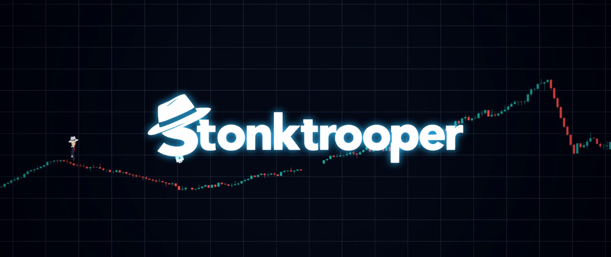

<p align="center">
  
</p>

<h1 align="center">The market is moving. So are you.</h1>

<p align="center">
  A financial arcade runner about candlesticks, briefcases, and questionable decisions.
  <br />
  <strong>No real money at risk. Just your pride.</strong>
</p>

<p align="center">
  <a href="https://www.stonktrooper.lol/"><strong>▶ Play in your browser</strong></a>
  &nbsp; · &nbsp;
  <a href="https://evanswhite.itch.io/stonktrooper">Play on itch.io</a>
  &nbsp; · &nbsp;
  <a href="https://github.com/MartinByalov/stonktrooper/issues">Report a bug</a>
</p>

---

## Welcome to the market

**Stonktrooper** is a browser game where you jump across a randomly generated
stock chart and try not to get liquidated. Throw briefcases at enemies, collect
pips, and survive the chaos of a fictional financial market and internet memes.

One missed jump. One unexpected black swan. One more attempt at a better score.

### What to expect

- **Trade the floor for a chart.** Navigate candlesticks, market gaps, and double-jump zones.
- **Weaponize your workday.** Aim and throw briefcases; collect a fedora for a different kind of market impact.
- **Meet the market.** Bulls, bears, whales, swans, and other financially questionable company.
- **Chase the pips.** Collect coins and diamonds, beat your best result, and share a score with friends.
- **Pick your terminal.** Light and dark themes, a satirical Live Feed, and configurable synthesized audio.
- **Take it with you.** Desktop controls and mobile touch controls, with landscape gameplay on mobile.

<table>
  <tr>
    <td align="center" width="50%">
      
      <br /><strong>Briefcase ready.</strong>
    </td>
    <td align="center" width="50%">
      
      <br /><strong>Risk management optional.</strong>
    </td>
  </tr>
</table>

## How to play

Open **How to Play** inside the game for the full illustrated guide, enemies,
pickups, and special encounters.

| Action | Desktop | Mobile |
| --- | --- | --- |
| Jump | **Space**, **W**, or **↑** | Tap the joystick |
| Double jump | Jump again inside a highlighted zone | Tap again inside a highlighted zone |
| Aim and throw | **Left mouse click** | Tap the game area |
| Move during boxing encounters | **A / D** or **← / →** | Use the joystick |
| Pause / resume | **Esc** or the pause control | Pause control |
| Restart a run | **R** during a run | Use the in-game restart controls |

On mobile, start the game in a browser that supports the requested fullscreen
mode and rotate to landscape if prompted. Audio begins after interaction.

<p align="center">
  <em>“Next time for sure!”</em><br />
  - Regard
</p>

---

## Run locally

Use **Node.js 22.12+** (or a newer supported LTS release) and npm.

```sh
git clone https://github.com/MartinByalov/stonktrooper.git
cd stonktrooper
npm ci
npm run dev
```

Open **http://localhost:5500**. The development server also listens on the local
network; some mobile features require HTTPS and browser fullscreen support.

### Commands

| Command | Purpose |
| --- | --- |
| `npm run dev` | Start the Vite development server on port 5500 |
| `npm run lint` | Run TypeScript checks (`tsc --noEmit`) |
| `npm run build` | Generate the production site in `dist/` |
| `npm run preview` | Preview the production build locally |
| `npm run clean` | Remove the generated `dist/` directory |

### Focused regression checks

```sh
node scripts/check-security.mjs
node scripts/check-chart-viewport.mjs
node scripts/check-chart-grid.mjs
node scripts/check-mobile-performance.mjs
node scripts/check-popup-colors.mjs
```

The direct TypeScript imports used by some checks need a Node version with
TypeScript type stripping, such as Node 22.18+ or Node 24.

`scripts/check-landscape-layout.mjs` contains browser-based layout checks. It
defaults to Microsoft Edge on Windows; use `EDGE_PATH` to select another
compatible Chromium executable. See `docs/mobile-validation.md` for the mobile
validation notes. Media capture and image optimization scripts are development
tools, not required to play or build the game.

## Under the hood

**React · TypeScript · Vite · Tailwind CSS · Canvas 2D · Web Audio API**

```text
src/                 Game simulation, canvas rendering, UI, and audio
public/images/       Artwork, retained PNG originals, and optimized web assets
public/stonks/       Runtime character-generator data and image layers
stonks/              Character generator source, standalone demo, and source data
scripts/             Regression checks, image optimization, and media tools
docs/                Development and validation notes
.github/workflows/   GitHub Pages build and deployment
```

The two Stonks directories serve different purposes: the game imports generator
code from `stonks/`, while static data and layers are served from
`public/stonks/`. Keep both. PNG originals are retained for regenerating optimized
assets with `scripts/optimize-images.py` (requires Python and Pillow).

### Deployment

Pushes to `main` run the GitHub Pages workflow: install dependencies, check
TypeScript, build, and deploy `dist/`. A manual workflow dispatch is also available.

The preferred site address is **https://www.stonktrooper.lol/**. Manage its custom
domain in **Settings → Pages** and DNS, not in a repository `CNAME` file; this
project deploys with a custom Actions workflow.

## Feedback

Found a broken interaction, an awkward mobile layout, or a particularly creative
way to get liquidated? Open an issue with your browser, device, steps to reproduce,
and a screenshot if possible.

This is a fictional arcade game, not a trading platform or financial advice.

**If you find any in-game bugs, it may be a feature!**
