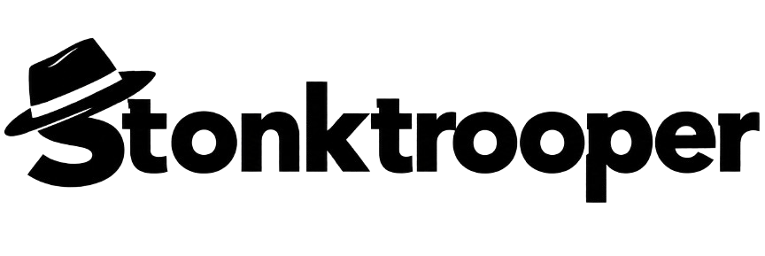
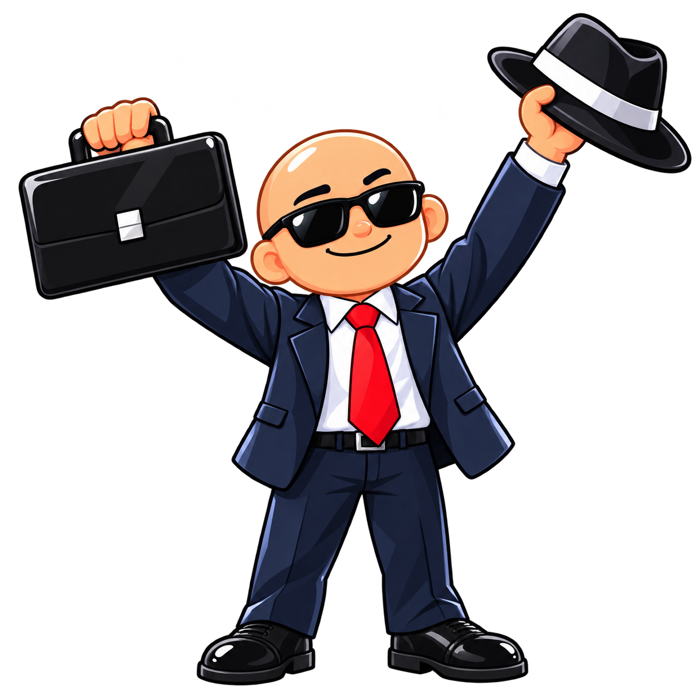

<p align="center">
  <picture>
    <source media="(prefers-color-scheme: dark)" srcset="public/images/logo-inverted.png">
    
  </picture>
</p>

<p align="center">
  <strong>The chart is the level. The market is the enemy. Your briefcase is the plan.</strong>
</p>

<p align="center">
  <a href="https://www.stonktrooper.lol/"></a>
  <a href="https://evanswhite.itch.io/stonktrooper"></a>
</p>

<p align="center"><em>Buy high. Jump higher. Get liquidated anyway.</em></p>

---

<table>
  <tr>
    <td width="38%"></td>
    <td>
      <h2>The pitch</h2>
      <p>You are a trader in a fedora, sprinting across a live candlestick chart. The candles are your floor, the gaps are your doom, and the market has opinions about you: bulls with baseball bats, bears with chainsaws, black swans dropping bags, and a boxing kangaroo who runs monetary policy.</p>
      <p>There is no real money here. Only pips, pride, and one more attempt.</p>
    </td>
  </tr>
</table>

## What happens on the chart

| | |
|---|---|
| 🦘 **Jump. Double jump. Collect.** | Gaps open without warning. Highlighted zones charge a double jump, and the diamond up there is worth it (it even takes a hit for you). |
| 💼 **Throw things at the market.** | Your briefcase means business. Pick up a fedora and it flies back like a boomerang; sometimes the bull just keeps it. |
| 🍌 **Apes together strong.** | Grab a banana and the apes join the run, throwing at anything that charges you. |
| 🐋 **Ride the whale.** | Land on a whale and it carries you over everything. Hit it right and it drops a banknote. |
| 🚀 **To the moon.** | The banknote lights a rocket. Ride the chart and swallow every coin on the way. |
| 🖨️ **Money printer go brrr.** | The pigeon's printer twists the chart into waves. Ride them, or walk away in shame. |
| 🗑️ **Take the dumbster ride.** | The hawk makes you an offer you can refuse. Accept it and the tendies double your pips. |
| 🔔 **Ring the bell.** | Climb to the bell and a boss rises out of the chart. Dodge, throw, survive. |

## Know your market

| | Who | What they do | What you do |
|---|---|---|---|
| 🐂 | **Bull** | Swings a baseball bat | Shoot it or stomp it |
| 🐻 | **Bear** | Brings a chainsaw | Same, but faster |
| 🤠 | **Trend Rider** | A bear riding a bull (or the other way round) | First hit drops the rider, the second the mount |
| 🦢 | **Black Swan** | Drops a bag on you | Hold the bag and you can't shoot |
| 🐦 | **Pigeon** | Aims for your hat | Keep your hat clean |
| 🦅 | **Hawk** | Offers a ride | Take the dumbster ride, collect the tendies |
| 🐋 | **Whale** | Too big to walk | Ride it, then take its banknote |
| 🦘 | **Jerome, Paul, Janet** | Bosses behind the bell | Lives on the line, briefcases in the air |

## Controls

| | Desktop | Mobile (landscape) |
|---|---|---|
| **Jump / double jump** | `Space`, `W` or `↑` | Tap the left side |
| **Throw** | Left click where you aim | Tap the right side |
| **Pause** | `Esc` | Pause button |
| **Restart** | `R` | Replay button |
| **Sound / Theme** | `M` / `N` | Settings |

<table>
  <tr>
    <td>
      <h2>Make it yours</h2>
      <p><strong>Day or Night.</strong> The whole chart switches theme with one key.</p>
      <p><strong>Your soundtrack.</strong> Pick the music style (funk and jazz on the trading desk, lo-fi, chiptune or house) and a style for every sound effect.</p>
      <p><strong>The Shmuck Feed.</strong> A satirical ticker of market "news" running over your run. Turn it off if the headlines hurt.</p>
      <p><strong>Show off the damage.</strong> Your score card is generated right in the browser, ready to post.</p>
    </td>
    <td width="36%"></td>
  </tr>
</table>

## Run it locally

```bash
npm install
npm run dev      # http://localhost:5500
npm run build    # production build in dist/
```

Built with React, TypeScript, Vite and Tailwind. Everything in a run (the chart, the hero, the
enemies, the bosses) is drawn on a canvas in real time; the music and effects are synthesized live
with the Web Audio API.

---

<p align="center">
  <br><br>
  A fictional arcade game. Not a trading platform, not financial advice.<br>
  Prices, charts, headlines and characters are made up. Scores have no monetary value.<br><br>
  <strong>If you find a bug, it may be a feature.</strong>
</p>
